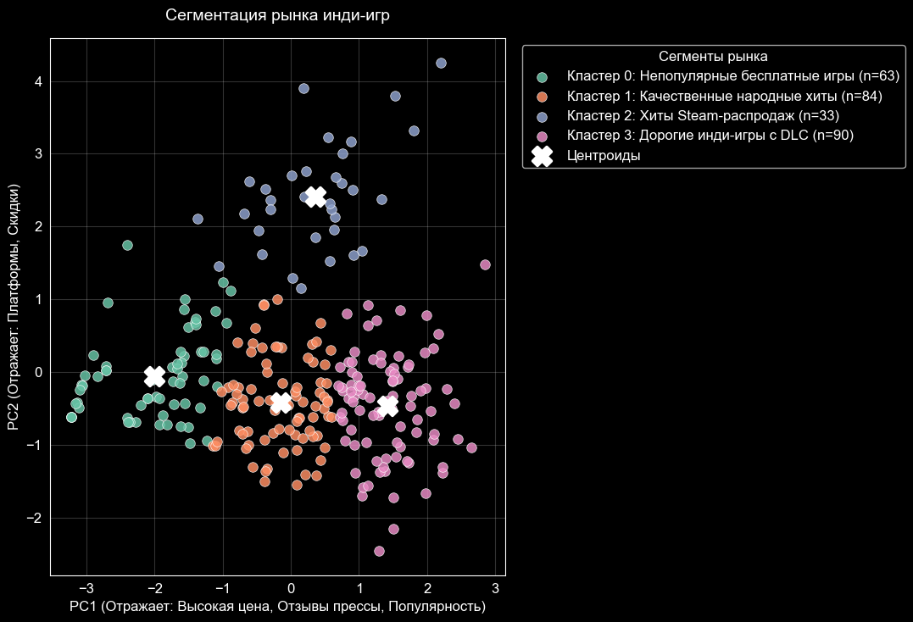

# Факторы популярности инди-игр в Steam

Анализ ценовых стратегий и продуктовых характеристик 280 игр в Steam. В проекте исследуются связи между популярностью, ценой, оценками критиков и игровыми режимами, а также выделяются группы игр со схожими характеристиками.

## Цель исследования

Определить, какие характеристики связаны с популярностью игр в выбранной группе и какие сегменты можно выделить по цене, скидкам и особенностям продукта. Показателем популярности служит число пользовательских рекомендаций.

## Данные

Датасет содержит 280 игр и 19 исходных признаков. Список игр получен через SteamSpy по тегу Indie с отбором по оценочному числу владельцев. Характеристики собраны через Steam Store API.

| Группа признаков | Содержание |
|---|---|
| Ценообразование | Текущая и базовая цена, размер скидки, бесплатная модель распространения |
| Популярность и оценки | Число рекомендаций, оценка Metacritic |
| Характеристики игры | Год выпуска, жанры, достижения, DLC |
| Платформы и режимы | Число платформ, одиночный режим, мультиплеер, кооператив |

### Подготовка данных

Проверены типы данных и пропуски, преобразованы бинарные признаки. Рассчитаны абсолютная скидка, ценовые категории и логарифм числа рекомендаций. Для регрессионных моделей отдельно учтено отсутствие оценки Metacritic.

## Методы

- Сбор данных через API, проверка пропусков и преобразование признаков.
- Разведочный анализ распределений и групповых различий.
- Корреляционный анализ и исследование таблиц сопряжённости.
- Линейная и логистическая регрессии.
- Стандартизация признаков, снижение размерности методом PCA и кластеризация K-Means.

## Основные результаты

- Цена и популярность. В исследуемой выборке более высокая текущая цена связана с большим числом рекомендаций.
- Оценки критиков. Среди игр с доступной оценкой Metacritic наблюдается положительная связь между оценкой и популярностью.
- Сегментация. По ценовым и продуктовым характеристикам выделены четыре группы игр.

Линейная и логистическая регрессии использованы для совместного анализа характеристик игр: модели распространения, оценок критиков, платформ и игровых режимов.

### Сегментация игр

Кластерный анализ позволил выделить группы с различными ценовыми профилями и уровнем популярности.

| Сегмент | Характеристика |
|---|---|
| Почти бесплатные игры | Низкая текущая цена и сравнительно небольшое число рекомендаций |
| Средний ценовой сегмент | Умеренная цена и относительно высокая популярность |
| Игры с крупными скидками | Существенное снижение цены на момент сбора данных |
| Более дорогие игры | Высокая текущая цена и небольшие скидки |



Сегментация отражает различия внутри исследуемой выборки. Названия групп описывают их характеристики на момент сбора данных.

## Стек

Python · pandas · NumPy · SciPy · statsmodels · scikit-learn · Matplotlib · Seaborn · requests

## Материалы

| Файл | Описание |
|---|---|
| [web_scraping.ipynb](notebooks/web_scraping.ipynb) | Получение и сохранение данных |
| [analysis.ipynb](notebooks/analysis.ipynb) | Подготовка данных, визуализации, модели и выводы |
| [steam_indie_games.xlsx](data/steam_indie_games.xlsx) | Исходный датасет |
| [presentation.pdf](reports/presentation.pdf) | Презентация исследования |

## Запуск

```bash
python -m pip install -r requirements.txt
python -m jupyter lab
```